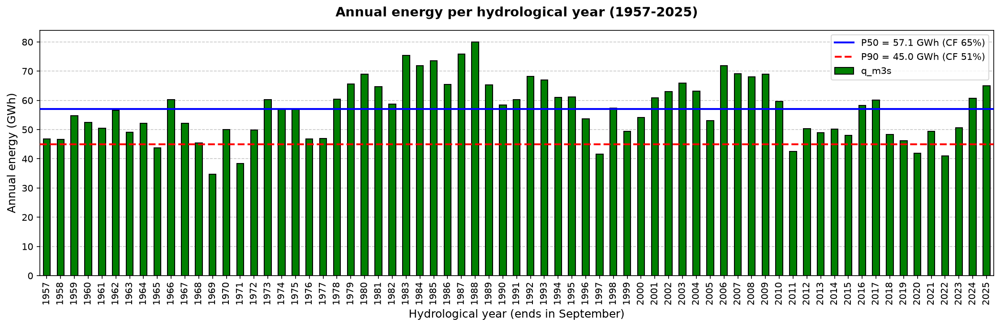

# hydro-project-finance
If a river's flow is less reliable than the bank assumes, how much less debt can the power plant take on?

## Project status:
Work in progress: Module A (hydrology) complete; financial model in progress

## Question and hypotheses:
 - Question: How much senior debt can a run-of-river power plant of approximately 10 MW on an Argentine river (with actual daily flow records) sustain, when sized based on a minimum DSCR calculated against P90 energy production; and what is the probability of breaching the DSCR covenant when historical hydrological variability is simulated?
 - Hypothesis:
    - H1: Debt capacity is determined by dry years, in particular by sequences of several consecutive dry years.
    - H2: The design-storm method changes the spillway CAPEX and the tail losses (flood damage and downtime), but has little impact on the debt sized at P90.
    - H3: If the years are modeled as independent (ignoring the fact that a dry year often follows another), the probability of breaching the covenant is underestimated. 
    [project charter](docs/project_charter.md)

## Data:
 - Data from the “Guido” flow measurement station on the “Mendoza” River, 15 km upstream of the Potrerillos reservoir (not regulated by it): Average daily flow measurements from the National Water Information System (SNIH) between 1956 and 2026 [https://snih.hidricosargentina.gob.ar/].
 - The raw data located in data/raw/ is never edited, in order to maintain its integrity. The processed data, on the other hand, is located in data/processed/.
 - The raw data contains 103 missing days (0.4%) that were imputed (D4) and validated in 1.12.

## Results from the hydrological module:
 - Base case: Ecological flow: 10% of the average flow (Tennant, 4.4 m3/s); 1 × Kaplan configuration; and design flow = Q30 of the available flow.
- Design flow: 43 m3/s ; Head: 26.9 m [design parameter, calculated based on 10 MW]; Power: 10 MW.
- Semiannual energy: 65.7% from Oct–Mar; P50/P90 values per semester are 38.0/29.8 GWh (Oct–Mar) and 18.7/13.6 GWh (Apr–Sep).

| Value | Annual energy (GWh) | Plant factor |
| :--- | :---: | :---: |
| Mean | 56.7 | 64.8% |
| P50 | 57.1 | 65.1% |
| P90 | 45.0 | 51.4% |
| P90 / P50 | 0.79 | |

 - Graph: Annual energy 
 

  - **Most important result:** The results from section 1.14 indicate a total of 24 runs (wet and dry years) against an expected 35.5, with a z-score of −2.79 and an autocorrelation of 0.64. This points to a persistence of dry years: independence is rejected at 95% confidence (a bad year tends to be followed by another bad year). Nevertheless, the impact on debt capacity will be analyzed in the subsequent stages (2 and 3).

 - Sensitivity Analysis: Comparative Table of Scenarios

| Scenario | P50 (GWh) | P90 (GWh) | P90/P50 | ΔP50 vs base (%) | ΔP90 vs base (%) |
| :--- | :---: | :---: | :---: | :---: | :---: |
| Base | 57.07 | 45.02 | 0.79 | 0.0 | 0.0 |
| Eco 20% | 50.92 | 36.30 | 0.71 | -10.8 | -19.4 |
| Eco 30% | 42.53 | 26.55 | 0.62 | -25.5 | -41.0 |
| Config A | 57.07 | 42.71 | 0.75 | 0.0 | -5.1 |
| No interpolated years | 57.84 | 44.19 | 0.76 | 1.4 | -1.8 |

Scenarios:
 - Eco 20%: ecological flow = 20% of the mean annual flow.
 - Eco 30%: ecological flow = 30% of the mean annual flow.
 - Config. A: 2 × Francis turbines of 21.5 m3/s.
 - No interpolated years: Excluding the 5 years with filled days.

 - The higher the ecological flow, the wider the gap between a typical year and a bad year, which is more risk for the bank. This effect works through two mechanisms:
    - Mec. 1) The ecological flow is deducted every day at the same rate. In winter, this represents a much larger fraction of the river's total flow than in summer.
    - Mec. 2) Pushes the number of days below the technical minimum: at 20%, the number of days with power 0 increases from 13 to 611
 - The effect of increasing the ecological flow is not proportional: it has a greater impact on poor years.

## Method:
 - data quality control: Rename rows and columns, standardize the data, and verify the results. Identify expected days, missing days, and duplicate dates.  
 - Hydrological year: Organize the time series by hydrological year; identify wet and dry years using own criteria [dry year = annual mean flow below the median of the 69 complete hydrological years (D5)].
 - Flow duration analysis: Filtering days by full years, organize the days in descending order, calculate the exceedance probability and calculate quantiles.
 - Ecological flow: Determine the Annual Average Flow (AAF),  Determine the ecological flow rate, Determine the turbinable flow rate and Calculate the quantiles.
 - Head, installed capacity and turbine type: Determine head using the power equation, determine the power generation thresholds for each configuration and determine the percentage of days below the threshold.
 - Daily power and energy: Filter the flow data to create 'q_turbined', and calculate power and energy , storing them in 'power_mw' and 'energy_mwh' series respectively. 
 - Annual energy, P50, P90 and plant factor: Obtain the energy generated per year, determine P50 and P90 values, determine the plant factor and identify the years below P90. The key ratio is P90/P50.
 - Sensitivity Analysis: create different scenarios (Eco 20%, Eco 30%, Config. A, No interpolated years) to measure how much the values of interest change (P50 ,P90, P90/P50, ΔP50 vs base (%), ΔP90 vs base (%)).
 - Analyze the persistence of dry years (1.14).
 - Organize the energy values into six month blocks (1.15, D10).

## Principal assumptions and limitations:
 - No official source was found that establishes a specific value or methodology for determining the ecological flow. Tennant 10% (VERIFICAR: no local regulation found); it is the most material assumption: at 20%, P90 falls 19.4% 
 - A constant value of η is assumed, even though many sources state that the efficiency ‘η’ varies depending on the flow rate entering the turbine.
 - A “head” value is set, and it is calculated based on a power output of 10 MW. This is a design parameter for a hypothetical power plant. The relevant limitation is that, with a low head and high flow rate, the cost per installed kW is higher (IRENA 2012, section 4.1): a factor that is factored into the CAPEX for stage 2.
 - We are assuming a hypothetical plant (one that does not currently exist), and it is also understood that all parameters that cannot be changed after the plant is built are fixed (such as the type of turbine, for example).
 - The average daily flow is assumed to be constant over a 24-hour period.
 - P90 treats each year as independent,  even though the data show dry streaks (persistence). Section 1.14 demonstrates that dry years are not purely independent (z = −2.79, autocorrelation 0.64). For this reason, it is necessary to perform resampling in stage 3 using blocks of years rather than individual years.
 - Country risk, the exchange rate, and the energy buyer's risk have not yet been modeled.

For a more complete list of assumptions and limitations, see: [DECISIONS.md](DECISIONS.md)

 ## Repo Structure:
 - Data
    - processed: .CSV file for further project stages
    - raw: SNIH data
 - Docs
    - figures: .png graph files
    - project_charter.md
 - Notebooks
    - 01_hydrology.ipynb: Main hydrology notebook
 - .gitignore
 - DECISIONS.md
 - LEARNING_LOG.md
 - LICENSE
 - README.md
 - environment.yml

 ## How to reproduce it:
```
   conda env create -f environment.yml
   conda activate hydro
   code .
```
   Then open `notebooks/01_hydrology.ipynb` and run all cells (VS Code or JupyterLab).

 ## Transparency:
LEARNING_LOG.md documents the entire learning process (what was done, reasons, what I learned, what I didn't understand), including any AI assistance received.

What the AI did:
 - Environment setup and debugging (Git, conda, VS Code kernel)
 - Code blocks: FDC plot, function skeleton (1.12), D4 validation block, semiannual export (1.15); direct file edits: loop variable rename, removal of invisible characters
 - Text: 1.11 markdown and interpretation, structure of D8 and D10, content checklists
 - Explanations of concepts, with sources
 - Source search and verification
 - Independent verification of all numerical results; README review and final audit
 - Personal study guide (PDF) and closing report, outside the repository

What I did:
 - Defined the research question, hypotheses (H1-H3) and project charter; set up the repository and the conda environment.
 - Selected the gauge (Guido, SNIH 1413) and the data; loaded and quality-checked 25,567 days of records.
 - Took and documented the decisions D1-D10 (gap filling, dry-year criterion, hydrological year, ecological flow, design flow, head, turbine configuration, P50/P90 method, semiannual periods), choosing between the alternatives and stating their limitations.
 - Wrote most of the notebook code (sections 1.0-1.14), including the persistence tests (1.14), and all checks against earlier results.
 - Found and fixed most bugs (calendar vs hydrological year, cumulative counters, design flow recalculated per scenario, isin on values vs index, dry-year counters).
 - Interpreted every result: percentage points vs relative change, days vs energy, P90/P50 gap, materiality ranking of assumptions.
 - Wrote the README, DECISIONS.md and LEARNING_LOG.md, and corrected them after each review.
 - Passed the stage gate: explained P50 vs P90 and the design-flow choice without notes.

## License: MIT