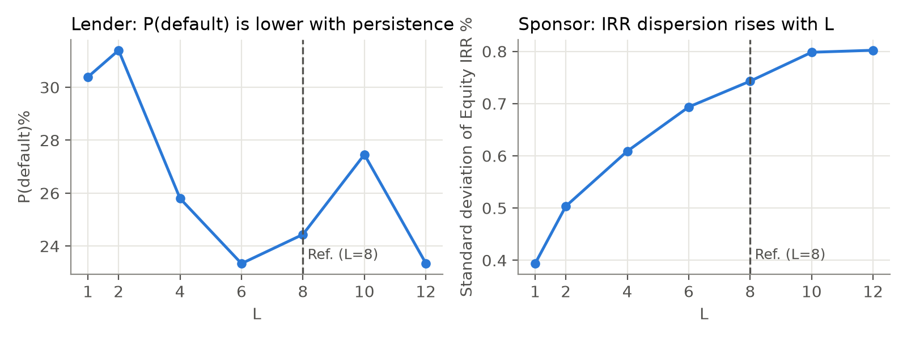
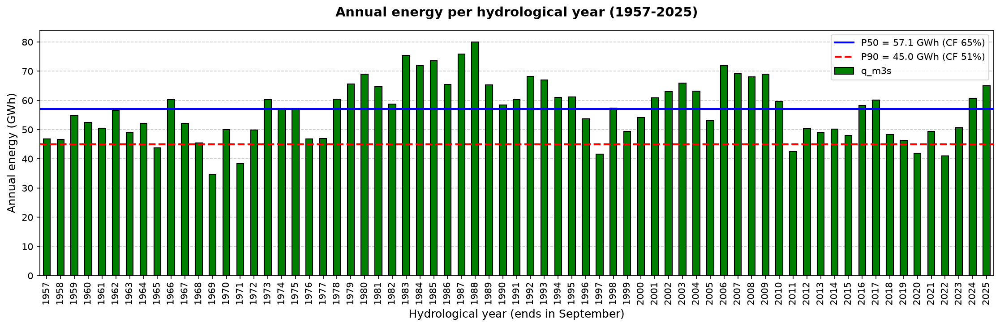
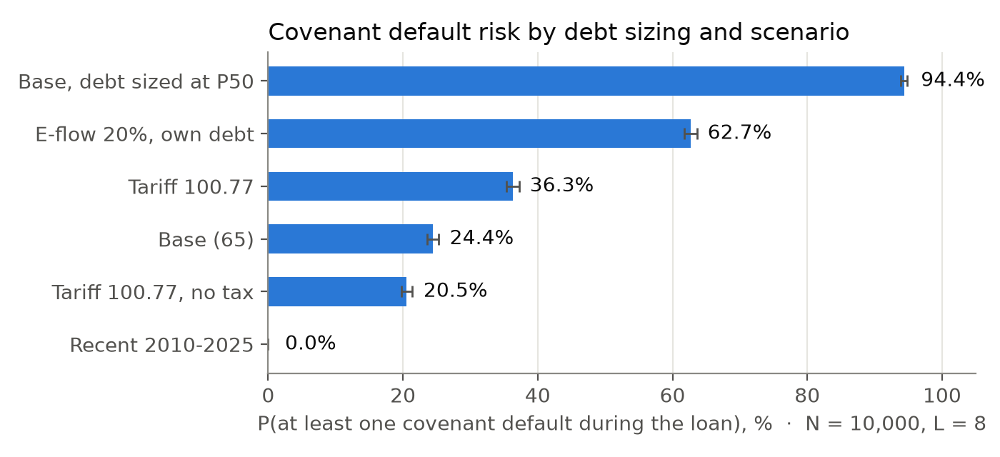
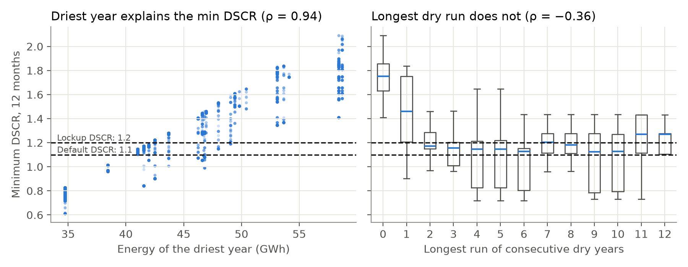

# hydro-project-finance
If a river's flow is less reliable than the bank assumes, how much less debt can the power plant take on?

## Project status:
Work in progress: Module A (hydrology), Stage 2 (financial model) and Stage 3 (Monte Carlo) complete; Next step: publish v1.

## Question and hypotheses:
 - Question: How much senior debt can a run-of-river power plant of approximately 10 MW on an Argentine river (with actual daily flow records) sustain, when sized based on a minimum DSCR calculated against P90 energy production; and what is the probability of breaching the DSCR covenant when historical hydrological variability is simulated?
 - Hypothesis:
    - H1: Debt capacity is determined by dry years, in particular by sequences of several consecutive dry years.
       - **Result:** H1 is partially rejected. Covenant risk is driven by dry years, but by the severity of the single driest year, not by sequences of consecutive dry years: every trajectory with a year below about 40.5 GWh defaults (9 out of 10 defaults), while long dry runs without such a year almost never do (0.3%). The minimum annual energy explains the minimum DSCR far better than the longest dry run (Spearman 0.94 vs −0.36). Long dry runs matter only for lock-ups (48.8% vs 42.7%). Tested on the fixed P90 debt (D31), using P(default) and the minimum DSCR as proxies for debt capacity.

    - H2: The design-storm method changes the spillway CAPEX and the tail losses (flood damage and downtime), but has little impact on the debt sized at P90.
       - **Result:** pending (v2, stage 5) 

    - H3: If the years are modeled as independent (ignoring the fact that a dry year often follows another), the probability of breaching the covenant is underestimated. 
       - **Result:** H3 is rejected for the lender: assuming independent years overstates the probability of a covenant default (30% vs 24%), because persistence concentrates the extreme dry years in fewer trajectories. It holds for the sponsor: independence halves the dispersion of the equity IRR. The direction of both effects was pre-registered in D30. The same happens with a tariff = 100.77 USD/MWh (47.8% vs 36.3%).
         
 - [Project charter](docs/project_charter.md)

## Data:
 - Data from the “Guido” flow measurement station on the “Mendoza” River, 15 km upstream of the Potrerillos reservoir (not regulated by it): Average daily flow measurements from the National Water Information System (SNIH) between 1956 and 2026 [https://snih.hidricosargentina.gob.ar/].
 - The raw data located in data/raw/ is never edited, in order to maintain its integrity. The processed data, on the other hand, is located in data/processed/.
 - The raw data contains 103 missing days (0.4%) that were imputed (D4) and validated in 1.12.

## Results from the hydrological module:
 - Base case: Ecological flow: 10% of the average flow (Tennant, 4.4 m3/s); 1 × Kaplan configuration; and design flow = Q30 of the available flow.
- Design flow: 43 m3/s ; Head: 26.9 m [design parameter, calculated based on 10 MW]; Power: 10 MW.
- Semiannual energy: 65.7% from Oct–Mar; P50/P90 values per semester are 38.0/29.8 GWh (Oct–Mar) and 18.7/13.6 GWh (Apr–Sep).

| Value | Annual energy (GWh) | Plant factor |
| :--- | :---: | :---: |
| Mean | 56.7 | 64.8% |
| P50 | 57.1 | 65.1% |
| P90 | 45.0 | 51.4% |
| P90 / P50 | 0.79 | |

 - Graph: Annual energy 
 

  - **Most important result:** The results from section 1.14 indicate a total of 24 runs (wet and dry years) against an expected 35.5, with a z-score of −2.79 and an autocorrelation of 0.64. This points to a persistence of dry years: independence is rejected at 95% confidence (a bad year tends to be followed by another bad year). Nevertheless, the impact on debt capacity will be analyzed in the subsequent stages (2 and 3).

 - Sensitivity Analysis: Comparative Table of Scenarios

| Scenario | P50 (GWh) | P90 (GWh) | P90/P50 | ΔP50 vs base (%) | ΔP90 vs base (%) |
| :--- | :---: | :---: | :---: | :---: | :---: |
| Base | 57.07 | 45.02 | 0.79 | 0.0 | 0.0 |
| Eco 20% | 50.92 | 36.30 | 0.71 | -10.8 | -19.4 |
| Eco 30% | 42.53 | 26.55 | 0.62 | -25.5 | -41.0 |
| Config A | 57.07 | 42.71 | 0.75 | 0.0 | -5.1 |
| No interpolated years | 57.84 | 44.19 | 0.76 | 1.4 | -1.8 |

Scenarios:
 - Eco 20%: ecological flow = 20% of the mean annual flow.
 - Eco 30%: ecological flow = 30% of the mean annual flow.
 - Config. A: 2 × Francis turbines of 21.5 m3/s.
 - No interpolated years: Excluding the 5 years with filled days.

 - The higher the ecological flow, the wider the gap between a typical year and a bad year, which is more risk for the bank. This effect works through two mechanisms:
    - Mec. 1) The ecological flow is deducted every day at the same rate. In winter, this represents a much larger fraction of the river's total flow than in summer.
    - Mec. 2) Pushes the number of days below the technical minimum: at 20%, the number of days with power 0 increases from 13 to 611
 - The effect of increasing the ecological flow is not proportional: it has a greater impact on poor years.

## Results from the financial model (Stage 2):
 - Model: [model/hydro_pf_model_v1.xlsx](model/hydro_pf_model_v1.xlsx) (v1.2), documented in the [model book](docs/model_book.md). Semiannual periods, 2-year construction, 30-year concession.
 - Base case: 10 MW, CAPEX 3,300 USD/kW, 20-year USD contract (MATER type) at 65 USD/MWh and recontracting afterwards at the same real price (D27); senior debt at 9% for 12 years, sculpted so that every 12-month DSCR equals 1.35, with a constant seasonal transfer from wet to dry semesters (D29); maximum gearing 70%.

| Debt sized on | Senior debt (USD M) | Debt / total uses | Binding constraint |
| :--- | :---: | :---: | :---: |
| P50 | 11.94 | 31.5% | DSCR |
| P90 | 8.04 | 21.6% | DSCR |

 - **Main answer:** sizing on P90 instead of P50 cuts senior debt by **32.65%** at 65 USD/MWh.
 - At 65 USD/MWh the project does not pay its cost of capital: project IRR 1.28%, equity IRR 0.37% (P90 case). The LCOE (P50, 9%) is 93.8 USD/MWh.
 - Required tariff (sponsor case, P50 energy with P90 debt, D28):
    - 100.77 USD/MWh for a project IRR equal to the cost of debt (9%).
    - 159.90 USD/MWh for an equity IRR equal to the hurdle rate (18.88%, Damodaran estimate, VERIFICAR).
    - Both are far above the 49-66 USD/MWh of MATER contracts in 2025 (wind and solar): this plant could not win a contract at those prices.
 - At 159.90 USD/MWh the debt reduction falls to 20.2% on the DSCR alone, because of operating leverage: fixed O&M weighs less as the price rises, so CFADS falls less than proportionally to energy (limit about 21%). The actual reduction is 9.3%, because the P50 debt hits the 70% gearing limit.
 - Most material assumption: the ecological flow. At 20% of the mean flow, P90 debt falls from 8.04 to 5.22 USD M (−35%), more than any financial sensitivity (price ±10%: ±18%; CAPEX ±15%: about ±12%).

## Results from the Monte Carlo simulation (Stage 3):
- **Main answer: Sizing on P90 instead of P50 cuts senior debt by 32.65% and lowers the probability of a covenant default during the loan from 94% to 24%.**

- Graph: P(default) by scenario


- Scenario table: P(default), P(lock-up), P(DSRA depleted), average equity IRR


| Metric | Base (65) | Tariff 100.77 | Tariff 100.77, no tax | Recent 2010-2025, L=8 | Recent 2010-2025, L=4 | E-flow 20%, own debt | Base, debt sized at P50 |
| :--- | :---: | :---: | :---: | :---: | :---: | :---: | :---: |
| **Min DSCR 12m** | 1.18 | 1.15 | 1.25 | 1.16 | 1.17 | 1.04 | 0.79 |
| **P(lockup)** | 57.6% | 60.9% | 39.8% | 81.2% | 80.5% | 67.6% | 97.1% |
| **Average lockup semesters** | 1.27 | 1.35 | 0.72 | 1.66 | 1.68 | 1.57 | 9.51 |
| **P(default)** | 24.4% | 36.3% | 20.5% | 0.0% | 0.0% | 62.7% | 94.4% |
| **P(DSRA depleted)** | 10.0% | 1.5% | 1.5% | 12.0% | 12.3% | 76.4% | 42.3% |
| **Sponsor support (USD)** | 2,628 | 0 | 674 | 6,582 | 6,680 | 208,076 | 88,513 |
| **Equity IRR** | 3.1% | 8.3% | 10.8% | 1.9% | 1.9% | 1.8% | 2.7% |


- **Findings**:
    - A single extreme year triggers a default: 9 out of 10 defaults stem from trajectories that include a year with a value below 40.5 GWh.
      
    - P90 is pessimistic on average, but not at the extremes: it assumes 45 GWh every year and never accounts for a year like 1969 (34.7 GWh).
    - At viable tariff (100.77 USD/MWh), the default probability (P(default)) rises from 24% to 36% due to the timing of taxes: in a wet year, tax losses are utilized sooner than the "sculpting" process had assumed (without taxes, the figure would be 21%).
    - With a 20% e-flow and with its own P90 debt (5.22 M USD), the probability of default is 63%: a fixed ecological flow increases the relative dispersion during dry years.

## Method:
 - data quality control: Rename rows and columns, standardize the data, and verify the results. Identify expected days, missing days, and duplicate dates.  
 - Hydrological year: Organize the time series by hydrological year; identify wet and dry years using own criteria [dry year = annual mean flow below the median of the 69 complete hydrological years (D5)].
 - Flow duration analysis: Filtering days by full years, organize the days in descending order, calculate the exceedance probability and calculate quantiles.
 - Ecological flow: Determine the Annual Average Flow (AAF),  Determine the ecological flow rate, Determine the turbinable flow rate and Calculate the quantiles.
 - Head, installed capacity and turbine type: Determine head using the power equation, determine the power generation thresholds for each configuration and determine the percentage of days below the threshold.
 - Daily power and energy: Filter the flow data to create 'q_turbined', and calculate power and energy , storing them in 'power_mw' and 'energy_mwh' series respectively. 
 - Annual energy, P50, P90 and plant factor: Obtain the energy generated per year, determine P50 and P90 values, determine the plant factor and identify the years below P90. The key ratio is P90/P50.
 - Sensitivity Analysis: create different scenarios (Eco 20%, Eco 30%, Config. A, No interpolated years) to measure how much the values of interest change (P50 ,P90, P90/P50, ΔP50 vs base (%), ΔP90 vs base (%)).
 - Analyze the persistence of dry years (1.14).
 - Organize the energy values into six month blocks (1.15, D10).
 - Resample complete hydrological years with a circular block bootstrap.
 - Select L = 8 using Politis-White (D33), with fixed debt (D31)
 - Develop a cash flow chain, replicating the logic from the Excel model in Python—and reconcile it against the Excel model across 6 scenarios using `pytest` (D32).
 - Set a fixed value of N (N = 10,000) by performing convergence tests and verified seed tests (D38).
 - Pre-register the expected direction of each H3 metric before running the simulation (D30).

## Principal assumptions and limitations:
 - No official source was found that establishes a specific value or methodology for determining the ecological flow. Tennant 10% (VERIFICAR: no local regulation found); it is the most material assumption: at 20%, P90 falls 19.4% 
 - A constant value of η is assumed, even though many sources state that the efficiency ‘η’ varies depending on the flow rate entering the turbine.
 - A “head” value is set, and it is calculated based on a power output of 10 MW. This is a design parameter for a hypothetical power plant. The relevant limitation is that, with a low head and high flow rate, the cost per installed kW is higher (IRENA 2012, section 4.1): a factor that is factored into the CAPEX for stage 2.
 - We are assuming a hypothetical plant (one that does not currently exist), and it is also understood that all parameters that cannot be changed after the plant is built are fixed (such as the type of turbine, for example).
 - The average daily flow is assumed to be constant over a 24-hour period.
 - The recent period (D35), spanning from 2010 to 2025, is analyzed as a short 16-year sample.
 - In stage 2, a simplification is applied (decision D11): in the Excel model, all cases are distributed according to the seasonal profile of the base case (65.7% from October to March), whereas the actual series, with a 20% e-flow, has a different profile, with 71% occurring from October to March. It overstates DSRA depletion and sponsor support in that scenario; P(default) is unaffected (D36)
 - The power plant loses money during the dry semesters from years 13 to 20. This is not a problem for the bank, but it is for the sponsor.
 - Bootstrapping cannot generate years that are drier than those in the historical record, as it is based on the historical series of years.
 - Country risk, the exchange rate, and the energy buyer's risk have not yet been modeled.
 - Financial model: no terminal value; price fixed in nominal USD during the contract; spot exposure after the contract only as a sensitivity (D27); the equity hurdle rate is an estimate (VERIFICAR); the required tariffs come from manual Goal Seek rounds (±0.10 USD/MWh). Full list in the [model book](docs/model_book.md), section 10.

For a more complete list of assumptions and limitations, see: [DECISIONS.md](DECISIONS.md)

## Repo Structure:
 - Data
    - processed
       - annual_energy.csv
       - semiannual_energy.csv
       - montecarlo_results.csv
    - raw: SNIH data
 - Docs
    - figures: .png graph files
    - model_book.md: documentation of the financial model
    - project_charter.md
 - Exercises: practice workbooks (sculpting)
 - Model
    - hydro_pf_model_v1.xlsx: project finance model (Stage 2)
 - Notebooks
    - 01_hydrology.ipynb: Main hydrology notebook
    - 03_montecarlo.ipynb: Monte Carlo notebook
 - src
    - cashflow.py
    - bootstrap.py
 - tests
    - fixtures
       - eco20_p90debt.xlsx
       - eco20_sized.xlsx
       - p50_p90debt.xlsx
       - p50_sized.xlsx
       - tariff100_p90.xlsx
    - test_reconciliation.py
 - .gitignore
 - DECISIONS.md
 - LEARNING_LOG.md
 - LICENSE
 - README.md
 - environment.yml

## How to reproduce it:
```
   conda env create -f environment.yml
   conda activate hydro
   python -m pytest
   code .
```
   Then open `notebooks/01_hydrology.ipynb` and run all cells (VS Code or JupyterLab). Then open `notebooks/03_montecarlo.ipynb` for the Monte Carlo analysis.

   Financial model: open `model/hydro_pf_model_v1.xlsx` in Excel (2013 or later) and follow the run procedure in the model book, section 4.3. The Checks sheet must show Model status = OK.

## Transparency:
LEARNING_LOG.md documents the entire learning process (what was done, reasons, what I learned, what I didn't understand), including any AI assistance received.

What the AI did:
 - Environment setup and debugging (Git, conda, VS Code kernel)
 - Code blocks: FDC plot, function skeleton (1.12), D4 validation block, semiannual export (1.15); direct file edits: loop variable rename, removal of invisible characters
 - Text: 1.11 markdown and interpretation, structure of D8 and D10, content checklists
 - Explanations of concepts, with sources
 - Source search and verification
 - Independent verification of all numerical results; README review and final audit
 - Stage 2: research of sources (MATER, spot prices, Damodaran, Bodmer), proposed formula designs (sculpting window, zero-debt guards), independent recalculation of the model in Python, and edits to DECISIONS.md, the model book and this README
 - Personal study guide (PDF) and closing report, outside the repository
 - Stage 3: explanations of concepts with sources; code skeletons for each block of the cash flow chain, the bootstrap sampler and the simulation loop; the reconciliation test (I added four of its checks); chart 1 and the chart style; bug detection; the initial definition of the DSRA and sponsor metrics, which had an error later corrected (D34); the diagnosis of the tax-timing and seasonal-profile mechanisms (D36); independent verification of all results; minor README fixes

What I did:
 - Defined the research question, hypotheses (H1-H3) and project charter; set up the repository and the conda environment.
 - Selected the gauge (Guido, SNIH 1413) and the data; loaded and quality-checked 25,567 days of records.
 - Took and documented the decisions D1-D10 (gap filling, dry-year criterion, hydrological year, ecological flow, design flow, head, turbine configuration, P50/P90 method, semiannual periods), choosing between the alternatives and stating their limitations.
 - Wrote most of the notebook code (sections 1.0-1.14), including the persistence tests (1.14), and all checks against earlier results.
 - Found and fixed most bugs (calendar vs hydrological year, cumulative counters, design flow recalculated per scenario, isin on values vs index, dry-year counters).
 - Interpreted every result: percentage points vs relative change, days vs energy, P90/P50 gap, materiality ranking of assumptions.
 - Wrote the README, DECISIONS.md and LEARNING_LOG.md, and corrected them after each review.
 - Passed the stage gate: explained P50 vs P90 and the design-flow choice without notes.
 - Stage 3: the formulas of the cash flow chain in Python; the Excel fixtures; the pre-registered predictions (D30) and decisions D30-D40; the simulations, convergence and seed tests; the interpretation of the results (with guidance on the tax-timing and seasonal-profile mechanisms); charts 2 and 3

## License: MIT