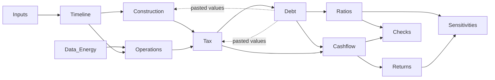

# Model Book: hydro_pf_model_v1.xlsx

## 0. Document control
| Field | Value |
|---|---|
| Model file | hydro_pf_model_v1.xlsx |
| Model version | v1.0 |
| Model Book version | 1.0 |
| Date | 30/10/2026 |
| Author | Ignacio Funes Deluigi |
| Reviewer | - |
| Status | Under review  |
| Related documents | data/processed/semiannual_energy.csv; 01_hydrology.ipynb. |
| Order of precedence | If this book and the workbook disagree, the workbook prevails and the difference is logged in Section 10.2 |

### 0.1 Change log
| Version | Date | Author | Sheets affected | Description of change | Effect on key outputs |
|---|---|---|---|---|---|
| 1.0 | 30/10/2026 | Ignacio Funes Deluigi | All | First complete version | n/a |

### 0.2 Review and sign-off
| Stage | Reviewer | Date | Scope | Result |
|---|---|---|---|---|
| Self-review | Ignacio Funes Deluigi | 30/10/2026 | Checks, sense tests (Section 8) | Pass |
| Supervisor review | [ ] | [ ] | Logic, assumptions, outputs | [ ] |

## 1. Summary

### 1.1 Project overview
Project finance model for a hypothetical 10 MW run-of-river hydropower plant on the Mendoza River (Mendoza, Argentina), using the daily flow record of the Guido gauge. The plant sells energy under a MATER-type USD contract at 65 USD/MWh, with a 24-month construction period and a 30-year water concession. The model sizes sculpted senior debt on P90 energy and computes ratios and returns.

### 1.2 Key dates
| Milestone | Date |
|---|---|
| Financial close | 01/10/2027 |
| COD and repayment start | 01/10/2029 |
| Debt maturity | 01/10/2041 |
| End of operations | 01/10/2059 |

### 1.3 Key results (base case: P90, sizing mode 1)
| Output | Value | Unit |
|---|---|---|
| Total uses | 37.19 | USD M |
| Senior debt | 8.06 | USD M |
| Debt / total uses | 21.7 | % |
| Binding constraint | DSCR | |
| Min 12-month DSCR | 1.35 | x |
| Min LLCR | 1.35 | x |
| Project IRR (annual, post-tax) | -0.67 | % |
| Equity IRR (annual) | -2.02 | % |
| Equity multiple | 0.70 | x |
| Model status | OK | |

Values correspond to model v1.0. Update this table with every new version.

## 2. Purpose, scope and intended use

### 2.1 Purpose
Answer the research question of the project: how much senior debt the plant can sustain when debt is sized on a minimum DSCR against P90 energy, and how much less this is than sizing on P50. Stage 3 (Monte Carlo) will use this model to estimate the probability of breaching the DSCR covenant.

### 2.2 Questions the model answers
- Debt capacity under DSCR and gearing constraints
- DSCR and LLCR profile over the loan life
- Project and equity IRR
- Effect of hydrology, price, CAPEX, rate and environmental flow

### 2.3 Questions the model does not answer
- The model does not make a valuation for a specific investor
- The model does not consider merchant price exposure
- The model does not consider FX risk 
- The model does not consider refinancing options
- The model does not simulate sequences of dry years (Stage 3)

### 2.4 Scope
| In scope | Out of scope |
|---|---|
| Construction, funding, fees, IDC | VAT and working capital |
| Energy, revenue, O&M | FX risk |
| Simplified income tax with loss carryforward | Major maintenance reserve (MRA) |
| Sculpted senior debt, DSRA | Decommissioning |
| Cash waterfall, lock-up and default flags | Refinancing, shareholder loans |
| Project and equity returns, sensitivities | Accounting statements (P&L, balance sheet) |

### 2.5 Intended users and use
Portfolio and academic use: the model supports the application of the author to master's programmes in finance and is reviewed by a project finance practitioner. All assumptions are estimates (see DECISIONS.md); the model is not intended for investment decisions without independent review.

### 2.6 Required precision
- Outputs reported in USD M to 2 decimals
- Ratios to 2 decimals
- Check tolerance: 0.0001 for debt and ratio checks; 1 USD for cash reconciliation checks; the master check is rounded to 4 decimals

## 3. Modelling conventions

| Topic | Convention |
|---|---|
| Standard | FAST Standard: one formula per row copied across the timeline; no hard-coded numbers in formulas |
| Formatting key | Blue font = input (Inputs sheet) and pasted values (Debt sheet); black font = formula results |
| Periodicity | Semiannual. S1 = Oct-Mar, S2 = Apr-Sep. Hydrological year starts 1 October and is labelled with the year in which it ends |
| Timing of cash flows | End of period. Flags are evaluated on the period start date (D16). Interest in operations on the opening balance; IDC and commitment fee on the average balance (D17) |
| Currency and price base | USD nominal. CAPEX input in 2024 USD, escalated at 2%/yr. Energy price flat in nominal terms (0% escalation). Fixed O&M escalated at 2%/yr |
| Interest rates | Inputs are annual; semiannual rate = annual / 2 (simple, not compounded) |
| Units | USD; GWh for hydrological data; MWh for energy sold; x for ratios |
| Signs | Values positive in their own rows and subtracted in totals; negative distributions = equity injection |
| Checks | 0 = pass. Each check sits at the bottom of its sheet; master check and model status on the Checks sheet |
| Circularity | No live circular references. Debt size, k and P90 debt service are pasted values (Section 4.3), in order to avoid circularity errors|
| Macros | None |
| Software | Built in Excel 2013: no MINIFS or later functions (AGGREGATE is used instead). Argument separator: comma; decimal separator: point |
| File naming | hydro_pf_model_v1.xlsx; versions are tracked with git commits |

## 4. Model map and operation

### 4.1 Sheet list
| # | Sheet | Type | Purpose | Feeds |
|---|---|---|---|---|
| 1 | Cover | Info | Purpose, colour legend, conventions | |
| 2 | Inputs | Input | All assumptions | All |
| 3 | Data_Energy | Data | Hydrological series and P50/P90 cases | Operations |
| 4 | Timeline | Calculation | Dates and flags | All calculation sheets |
| 5 | Construction | Calculation | CAPEX, funding, fees, IDC, Sources & Uses | Tax, Debt, Cashflow, Returns |
| 6 | Operations | Calculation | Energy, revenue, O&M, EBITDA | Tax |
| 7 | Tax | Calculation | Depreciation, tax losses, tax, post-tax CFADS | Debt, Cashflow, Ratios, Returns |
| 8 | Debt | Calculation | Debt sizing and sculpting | Construction, Tax, Cashflow, Ratios |
| 9 | Cashflow | Calculation | DSRA and cash waterfall | Returns |
| 10 | Ratios | Output | DSCR, LLCR | Sensitivities |
| 11 | Returns | Output | IRR, equity multiple | Sensitivities |
| 12 | Sensitivities | Output | Scenario results | |
| 13 | Checks | Check | Master check and model status | |

### 4.2 Logic flow

### 4.3 How to run the model
Mode 1 (size debt on the selected case):
1. Set the energy case selector (Inputs, row 6) and Debt sizing mode = 1 (Inputs, row 7). Change any other input for the scenario.
2. In Debt, copy Debt size (calculated, C15) and paste it as a value into Debt size (pasted value, C20); do the same from k (C17) to k pasted (C21). Repeat until the Debt checks equal 0 (usually one or two rounds).
3. Confirm Model status = OK in Checks.

Mode 2 (keep the P90 debt and repayment schedule):
1. First return to the base case (case 2, mode 1) and paste the P90 debt and k as in steps 2 and 3 above. Debt C20 must equal the P90 debt (8,064,962.53 in v1.0).
2. Set the energy case selector to the scenario case and Debt sizing mode = 2. Do not paste anything.
3. Confirm Model status = OK in Checks.

P90 debt service schedule: the row "Debt service P90 (pasted values)" in Debt is a snapshot of the base case debt service. Re-paste it (row 25 into row 28, as values, with case 2 and mode 1) only when a base case input changes.

Sensitivities: rerun each scenario manually with the steps above, paste the results as values in Sensitivities and return to the base case (case 2, mode 1, original inputs, P90 debt pasted).

Warning: while the Debt checks differ from 0, the outputs do not reflect the current inputs. Pasting a non-P90 debt and then switching to mode 2 makes the closing balance check fail.

## 5. Data and assumptions book

### 5.1 Data log
| Dataset | Content | Period | Unit | Source | Processing | Quality and limitations |
|---|---|---|---|---|---|---|
| Annual energy series | Base, e-flow 20%, e-flow 30%, configuration A, dry-year flag | 1957-2025 (hydrological years) | GWh/yr | Guido gauge (SNIH 1413), Mendoza River | Stage 1, notebooks/01_hydrology.ipynb | Missing days (0.40%) filled by linear interpolation and flagged (D4) |
| Semiannual energy series | Energy by half-year and Oct-Mar share | 1957-2025 | GWh | Stage 1 (data/processed/semiannual_energy.csv) | Semester 1: Oct-Mar, Semester 2: Apr-Sep (D10) | Base configuration only; seasonal share applied to the e-flow case (D23) |

### 5.2 Assumptions log
| ID | Parameter | Value | Unit | Label | Source | Decision | Sensitivity tested | Materiality |
|---|---|---|---|---|---|---|---|---|
| A-01 | Installed capacity | 10 | MW | EST | Design parameter (Stage 1) | D8 | No | High |
| A-02 | Availability factor | 92 | % | EST | Own criteria; personal communication | D12 | No | Medium |
| A-03 | Energy price | 65 | USD/MWh | EST | RenovAr to MATER | D12 | +/-10%; 2% escalation | High |
| A-04 | CAPEX | 3,300 | USD/kW | EST | IRENA 2024, table 6.3 | D13 | +/-15% | High |
| A-05 | Debt interest rate | 9 | %/yr | EST | Comparable: Genneia | D14 | +/-1 pt | Medium |
| A-06 | Target DSCR (P90) | 1.35 | x | EST | Forvis Mazars | D14 | No | High |
| A-07 | Maximum gearing | 70 | % | EST | Wall Street Prep | D14 | No (never binding) | Low |
| A-08 | Income tax rate | 35 | % | EST | PwC Tax Summaries | D15 | No | Medium |
| A-09 | Fixed O&M | 3 | % of CAPEX/yr | EST | IRENA | D12 | No | High |
| A-10 | Environmental flow | 10 | % of mean annual flow | EST | Tennant (1975) | D7 | 20% case | High |

The full list of inputs, with unit, label, source and decision, is in the Inputs sheet (columns A to F).

### 5.3 Implicit assumptions
- The energy of the selected case repeats every year of operation.
- Availability applies on top of case energy: the Stage 1 energy series assumes the plant is always available (D8, D12).
- The USD contract is collected with no FX loss.
- Fixed O&M is a percentage of base CAPEX in 2024 USD, escalated; it does not use nominal CAPEX.
- The tax depreciation base excludes IDC and fees.

## 6. Technical guide

Each sheet uses the same structure: Purpose, Inputs used, Structure, Key calculations, Outputs, Checks, Notes.

### 6.1 Inputs
- Purpose: single location for every hard-coded value.
- Structure: 1 General & timing; 2 Energy & revenue; 3 CAPEX & construction; 4 Operating costs; 5 Tax; 6 Debt.
- Columns: Parameter, Value, Unit, Label (OFICIAL / EST / VERIFICAR), Source, Decision.
- Selectors: energy case (1 P50, 2 P90, 3 Recent, 4 P90 e-flow 20%); debt sizing mode (1 size on selected case, 2 keep P90 schedule).
- Derived inputs: semiannual rate = annual rate / 2.
- Checks: CONTROL = sum of disbursement curve = 1.

### 6.2 Data_Energy
- Purpose: store the hydrological series and build the energy cases.
- Structure: annual series; statistics (P50, P90, recent P90); seasonal shares (full series and 2010-2025); case table; semiannual series.
- Key calculations:
  - P50 = PERCENTILE.INC(annual base energy 1957-2025, 0.5)
  - P90 = PERCENTILE.INC(annual base energy 1957-2025, 0.1)
  - Recent P90: same on 2010-2025
  - P90 e-flow 20%: same on e-flow 20% series
  - Semiannual split (method A) = annual case energy x average seasonal share (full series for P50, P90 and e-flow; recent shares for the recent case)
- Outputs: case table to Operations.
- Notes: method A (annual P90 x average seasonal share) and the use of the average of annual shares are justified in D11.

### 6.3 Timeline
- Purpose: time axis and phase flags.
- Key calculations:
  - Start date = previous end date + 1 (first period = financial close); end date = EOMONTH(start, 5)
  - COD = EDATE(financial close, construction months); repayment start = EDATE(COD, grace x 6); maturity = EDATE(COD, tenor x 12); end of operations = EDATE(COD, life x 12)
  - Construction flag = start >= financial close AND start < COD
  - Operations flag = start >= COD AND start < end of operations
  - Repayment flag = start >= repayment start AND start < debt maturity
  - Years from base = (start - 1 July of CAPEX base year) / 365.25
  - Years from COD = (start - COD) / 365.25 x operations flag
- Checks: flag counts (4 construction, 60 operating, 24 repayment); no phase overlap.

### 6.4 Construction
- Purpose: nominal CAPEX, funding, fees, IDC and Sources & Uses.
- Structure: CAPEX values; funding; fees and IDC; Sources & Uses; checks.
- Key calculations:
  - Base CAPEX = MW x 1,000 x USD/kW
  - Nominal CAPEX = base x disbursement % x (1 + CAPEX escalation)^years from base
  - Gearing applied = debt size / total construction cost; drawdown pro rata
  - IDC = average debt balance x semiannual rate
  - Commitment fee = average undrawn commitment x fee / 2
  - Upfront fee = fee x commitment, in the first period
  - Fees, IDC and initial DSRA funding are paid with equity
- Outputs: nominal CAPEX to Tax and Returns; fees and IDC to Tax; total equity to Returns; total uses to the gearing limit.
- Checks: disbursement = 100%; drawdown + equity = cost; balance at COD = commitment; sources = uses.

### 6.5 Operations
- Key calculations:
  - Gross energy = case energy for S1 or S2 x operations flag
  - Net energy (MWh) = gross energy x availability x 1,000
  - Revenue = net energy x price x price escalation index
  - Fixed O&M = % x base CAPEX / 2 x O&M escalation index
  - EBITDA = revenue - operating costs; pre-tax CFADS = EBITDA
- Checks: total energy = annual energy x life; revenue reconciliation; costs >= 0.

### 6.6 Tax
- Key calculations:
  - Depreciable base = nominal CAPEX + contingency + development costs (IDC and fees excluded, Decree 862/2019 art. 207)
  - Per semester of operation: civil works = base x share / 50 / 2; equipment = base x (1 - share) / 10 / 2, only in the first 20 operating semesters
  - Taxable income = EBITDA - depreciation - construction financing costs - operating interest
  - Losses expire after 5 years (10 semesters) and are used FIFO: closing balance = MIN(balance before expiry, losses generated in the last 10 semesters, SUMIFS)
  - Tax = (max(0, taxable income) - losses used) x 35%
  - CFADS = EBITDA - tax paid
- Checks: depreciation total; tax >= 0; loss corkscrew closes.

### 6.7 Debt
- Key calculations:
  - Max debt service = CFADS / target DSCR x repayment flag
  - DSCR capacity = sum of PV(max debt service) at the semiannual rate
  - Gearing limit = max gearing x total uses
  - Debt size = MIN(DSCR capacity, gearing limit); k = debt size / DSCR capacity
  - Debt service = pasted k x max debt service (mode 1) or pasted P90 debt service (mode 2)
  - Principal = debt service - interest
- Circularity: debt size feeds IDC, interest feeds tax, tax feeds CFADS. Resolved by pasted values (Section 4.3).
- Checks: pasted = calculated (debt, k; skipped in mode 2); closing balance at maturity = 0.

### 6.8 Cashflow
- Key calculations:
  - DSRA target = DSRA months / 12 x debt service of the next two semesters
  - Initial DSRA funding from equity in the last construction period
  - Top-up = MIN(target - opening, cash after debt service), when both positive; withdrawal = MIN(opening, cash shortfall); release = balance above target
  - Cash available = cash after debt service - top-up + withdrawal + release
  - Lock-up if 12-month DSCR < 1.20; default flag if < 1.10 (information only)
  - Distributions = opening retained cash + cash available; during lock-up, cash is retained and sponsors only inject cash to cover shortfalls (D24). Negative distributions = equity injections
- Checks: DSRA >= 0 and 0 at the end; retained cash >= 0; cash reconciliation.

### 6.9 Ratios
- Semiannual DSCR = CFADS / debt service
- 12-month DSCR = sum of CFADS over 2 semesters / sum of debt service over 2 semesters
- LLCR = PV(CFADS to maturity at debt rate) / opening debt balance
- Check: first-semester LLCR = target DSCR (skipped in mode 2).
- Min and average ratios over repayment periods only, with AGGREGATE and AVERAGEIF.

### 6.10 Returns
- Project cash flow = -total construction cost (CAPEX, contingency, development) + post-tax CFADS (pre-financing; the tax line includes the interest deduction)
- Equity cash flow = -total equity contribution + distributions
- Annual IRR = (1 + semiannual IRR)^2 - 1
- Equity multiple = sum of distributions / sum of contributions
- Notes: no terminal value; cash flows end with the concession.

### 6.11 Sensitivities
- Procedure to regenerate results: manual, following Section 4.3. Results in Section 9.2. Main answer cell: Sensitivities D20 = 1 - P90 debt / P50 debt.

### 6.12 Checks
- Total checks = ROUND(sum of |checks|, 4); Model status = IF(total = 0, "OK", "ERROR"). Lock-up and default counts are shown as information and do not enter the total.

## 7. Checks and alerts

| ID | Sheet | Check | Pass condition | Type |
|---|---|---|---|---|
| C-01 | Timeline | Construction flag count | 0 | Integrity |
| C-02 | Timeline | Operations flag count | 0 | Integrity |
| C-03 | Timeline | Repayment flag count | 0 | Integrity |
| C-04 | Timeline | Phase overlap | 0 | Integrity |
| C-05 | Construction | Disbursement % - 1 | 0 | Integrity |
| C-06 | Construction | Total nominal CAPEX | 0 | Integrity |
| C-07 | Construction | Drawdown + equity - construction cost | 0 | Integrity |
| C-08 | Construction | Closing balance at COD - commitment | 0 | Integrity |
| C-09 | Construction | Sources - uses | 0 | Integrity |
| C-10 | Operations | Total energy - annual energy x life | 0 | Integrity |
| C-11 | Operations | Revenue | 0 | Integrity |
| C-12 | Operations | Operating costs >= 0 | 0 | Integrity |
| C-13 | Tax | Depreciation total | 0 | Integrity |
| C-14 | Tax | Tax paid >= 0 | 0 | Integrity |
| C-15 | Tax | Loss corkscrew | 0 | Integrity |
| C-16 | Debt | Pasted debt = calculated debt | 0 | Integrity (pasted values current) |
| C-17 | Debt | Pasted k = calculated k | 0 | Integrity (pasted values current) |
| C-18 | Debt | Closing balance at maturity | 0 | Integrity |
| C-19 | Cashflow | DSRA >= 0 | 0 | Integrity |
| C-20 | Cashflow | DSRA in last column | 0 | Integrity |
| C-21 | Cashflow | Retained cash >= 0 | 0 | Integrity |
| C-22 | Cashflow | Cash reconciliation | 0 | Integrity |
| C-23 | Ratios | First LLCR - target DSCR | 0 | Integrity |
| AL-01 | Cashflow | Lock-up flag count | 0 in the base case | Information (covenant) |
| AL-02 | Cashflow | Default flag count | 0 in the base case | Information (covenant) |

## 8. Testing and QA log

| ID | Test | Expected behaviour | Result | Status |
|---|---|---|---|---|
| T-01 | P50 vs P90 sizing | P50 debt > P90 debt | 11.96 vs 8.06 USD M | Pass |
| T-02 | Price +10% | Debt and IRR rise | Debt 9.52 USD M; project IRR 0.64% | Pass |
| T-03 | Rate +/-1 pt | Project IRR unchanged; debt moves inversely | Project IRR -0.67% in both | Pass |
| T-04 | CAPEX +15% | IRR falls; debt falls through higher O&M | Debt 7.09 USD M | Pass |
| T-05 | Price = 0 | Revenue 0; no debt capacity | Not run | Open |
| T-06 | Independent recalculation of all 12 scenarios outside the workbook (Python replica, AI-assisted review) | Matches model | Debt to the dollar; ratios and IRRs to 4 decimals | Pass |
| T-08 | E-flow 20% with P90 debt (case 4, mode 2) | Checks pass; covenant breaches flagged | Model status OK; 24 lock-up and 24 default semesters; DSRA depleted in semester 14 | Pass |
| T-09 | Model status in every case | OK in cases 1-4 (mode 2) and in the base case | OK | Pass |
| T-07 | Principal >= 0 every period | No negative amortisation | Fails in S2 semesters | Open (I-01) |

## 9. Scenarios, sensitivities and uncertainty

### 9.1 Scenario definitions
| Scenario | Change vs base | Case | Mode |
|---|---|---|---|
| Base P90 | None | 2 | 1 |
| P50 sized | P50 energy | 1 | 1 |
| P50 with P90 debt | P50 energy, P90 debt schedule | 1 | 2 |
| Recent 2010-2025 | Recent hydrology | 3 | 1 |
| E-flow 20% | Environmental flow | 4 | 1 |
| Price +/-10% | Energy price | 2 | 1 |
| CAPEX +/-15% | USD/kW | 2 | 1 |
| Rate +/-1 pt | Debt interest rate | 2 | 1 |
| Price escalation 2% | 2%/yr on price | 2 | 1 |
| Availability 88% | Availability factor 92% to 88% | 2 | 1 |

### 9.2 Results (model v1.0)
| Scenario | Debt (USD M) | Debt % uses | Min 12m DSCR | Project IRR | Equity IRR |
|---|---|---|---|---|---|
| Base P90 | 8.06 | 21.7% | 1.35 | -0.67% | -2.02% |
| P50 sized | 11.96 | 31.6% | 1.35 | 2.54% | 0.95% |
| P50 with P90 debt | 8.06 | 21.7% | 1.87 | 2.51% | 1.48% |
| Recent 2010-2025 | 7.18 | 19.4% | 1.35 | -1.63% | -2.91% |
| E-flow 20% | 5.25 | 14.3% | 1.35 | -4.23% | -5.35% |
| Price +10% | 9.52 | 25.4% | 1.35 | 0.64% | -0.81% |
| Price -10% | 6.61 | 17.9% | 1.35 | -2.30% | -3.53% |
| CAPEX +15% | 7.09 | 16.7% | 1.35 | -2.85% | -4.05% |
| CAPEX -15% | 9.04 | 28.2% | 1.35 | 1.54% | 0.02% |
| Rate +1 pt | 7.70 | 20.7% | 1.35 | -0.67% | -2.09% |
| Rate -1 pt | 8.46 | 22.8% | 1.35 | -0.67% | -1.94% |
| Price escalation 2% | 9.50 | 25.4% | 1.35 | 2.57% | 1.48% |
| Availability 88% | 7.43 | 20.0% | 1.35 | -1.35% | -2.65% |

Debt reduction from P90 vs P50 sizing: 32.6%. All scenarios are DSCR-bound.

### 9.3 Uncertainty register
| Source | Treatment in model | Quantified |
|---|---|---|
| Interannual hydrology | P50 / P90 / recent cases | Partially (no dry-year sequences) |
| Environmental flow | E-flow 20% case | Yes |
| CAPEX | +/-15% | Yes |
| Energy price | +/-10%, 2% escalation | Yes |
| Interest rate | +/-1 pt | Yes |
| Availability | 88% case | Yes |
| Regulatory / tax | Fixed | No |

## 10. Known limitations and issue log

### 10.1 Limitations
- Constant case energy every year; no sequences of dry years.
- Flat nominal price while O&M escalates at 2%/yr.
- Fees and IDC funded with equity and expensed for tax; the tax interpretation has not been reviewed by a tax advisor (D19).
- Losses expire after 5 years (USD 7.7 M expire in the base case).
- 40% of the civil works base is not depreciated within the 30-year life (D19).
- Negative CFADS in the dry semesters of 2056-2059 (D21).
- Sponsor support during lock-up is assumed unlimited; default consequences are not modelled (D24).
- Sensitivities change one assumption at a time; sizing on P90 at 1.35x is a conservative lender practice (D23).
- An e-flow of 20% is not compatible with the debt sized on the base flow (D24).
- No VAT, working capital, FX, MRA or decommissioning.
- Debt circularity resolved by pasted values; rerun required after input changes.

### 10.2 Issue log
| ID | Sheet | Description | Impact | Status |
|---|---|---|---|---|
| I-01 | Debt | Semiannual sculpting produces negative principal in S2; balance rises (e.g. 7.52 to 7.59 USD M in period 6) | Lenders would not accept negative amortisation | Open |
| I-02 | Inputs | Label for Energy price shows "0" instead of OFICIAL/EST/VERIFICAR | Documentation | Closed |
| I-03 | Tax | Interest row label still reads "placeholder, linked in step 2.6" | Labelling | Closed |

## Appendix A. Glossary
| Term | Definition |
|---|---|
| CFADS | Cash flow available for debt service |
| COD | Commercial operation date |
| DSCR | Debt service coverage ratio = CFADS / debt service |
| LLCR | Loan life coverage ratio = PV(CFADS over loan life) / debt outstanding |
| DSRA | Debt service reserve account |
| IDC | Interest during construction |
| k | Debt adjustment factor = debt size / DSCR debt capacity |
| P50 / P90 | Annual energy exceeded with 50% / 90% probability |
| E-flow | Environmental flow kept in the river |
| MATER | Argentine term market for renewable energy |
| Sculpting | Repayment profile set so DSCR equals the target each period |
| Lock-up | Distribution block when DSCR falls below the covenant |

## Appendix B. References
- [DECISIONS.md](../DECISIONS.md): every assumption with its reason, limitations and sources (D1-D24).
- [README.md](../README.md): research question, hypotheses and Stage 1 results.
